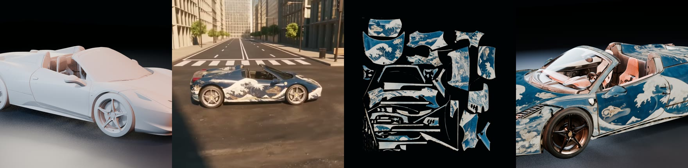
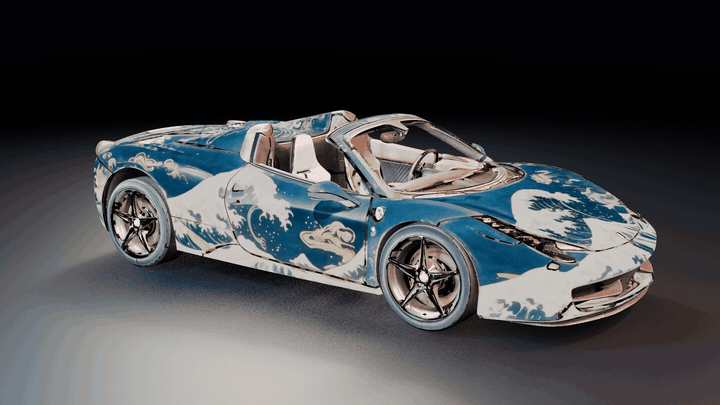
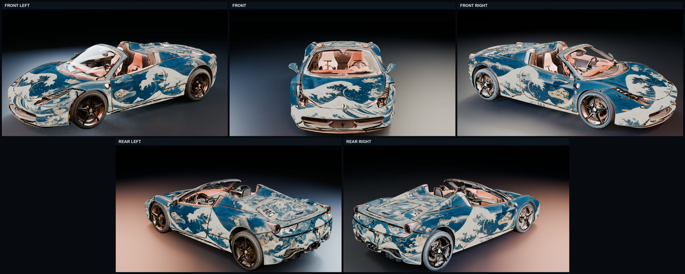

# video-to-texture

**Render a 3D asset with a known camera, let an AI video model restyle that exact camera
move, then fit the video back onto the original mesh as a real UV texture.**



<sub>clay orbit · Seedance 2.5 video · fitted + completed UV atlas · final textured mesh</sub>

The test asset is a Ferrari 458 Spider in clay, parked in a procedural city. The look
(an ukiyo-e livery in indigo and gold) exists only in an AI-generated video. The output
is the same mesh with baked UV atlases you can open in Blender or export as GLB.

The key idea: because the AI video was generated **from our own Blender orbit**, every
video frame comes with a known camera pose. No structure-from-motion and no new
geometry: just an optimization of the texture under fixed cameras.

## The unfold

The body mesh morphing into its own UV atlas: every island you see is a piece of the
AI video, baked onto real UVs.

<p align="center"></p>

## Pipeline

| # | Step | Tool / model | What it does | Code |
|---|---|---|---|---|
| 1 | Clay orbit | Blender | 30 s, 24 fps, 2-revolution spiral orbit; camera poses are known | [`pipeline/01_orbit`](pipeline/01_orbit) |
| 2 | AI video | Seedream 5 Pro edit → Seedance 2.5 reference-to-video (fal) | styled reference still from frame 1, then a 720p video of the same camera move | [`pipeline/02_ai_video`](pipeline/02_ai_video) |
| 3 | Texture fit | nvdiffrast on a fal Serverless H100 (`fal run`) | fits one static UV atlas to 120 frames, cameras and mesh fixed | [`pipeline/03_fit`](pipeline/03_fit) |
| 4 | Re-unwrap + rebake | Blender, UVgami seams, H100 baker | clean UV islands per material page, video re-projected into them | [`pipeline/04_unwrap`](pipeline/04_unwrap) |
| 5 | Complete + upscale | Seedream 5 Pro edit, Topaz (fal) | fills seams / never-seen texels per atlas, upscales to native 4K / 8K | [`pipeline/05_seedream`](pipeline/05_seedream) |
| 6 | Assemble | Blender | swaps the final atlases onto the mesh, renders, exports | [`pipeline/06_assemble`](pipeline/06_assemble) |

The explainer film itself is code too: [`explainer/`](explainer).

## Quickstart

Requirements: Blender (headless), Python 3.10+, `ffmpeg`, a fal account with `FAL_KEY`
set in your environment (never hard-code it), and the `fal` CLI for step 3.

```bash
# 1. key the orbit on your scene, then render it in clay to a 1280x720 / 24 fps mp4
blender -b scene.blend -P pipeline/01_orbit/rig_v2.py

# 2. styled reference + styled video (paid)
python pipeline/02_ai_video/generate.py reference --frame clay_frames/frame_0001.png
python pipeline/02_ai_video/generate.py video --clay clay_orbit_720p24.mp4 --reference out/seedream_0.png

# 3. dataset, mattes, fit on an H100
python pipeline/03_fit/prepare_dataset.py
python pipeline/03_fit/run_video_mask.py && python pipeline/03_fit/add_masks_to_dataset.py
DATASET_URL=<uploaded dataset_v03_masked.zip> fal run pipeline/03_fit/fit_run.py::fit_texture

# 4-6. see each step's README
```

Steps 1-3 are the core method and the most self-contained code. Steps 4-6 are a
research snapshot: hash-pinned to intermediate data we do not ship, kept as a reference
implementation.

## Results we recorded




| | Atlas | Median silhouette IoU | Held-out masked L1 | H100 time |
|---|---|---:|---:|---:|
| Step 3, v1 | 4096² | 0.844 | 0.102 | 55.8 s |
| Step 3, HQ (SeedVR 2160p input, 1024 px crops) | 8192² | — | 0.108 | 219 s |

The 8K fit looked about the same as the 4K one. The ceiling is the source: in the 720p
video the car is about 374 px wide in a median frame. Steps 4-5 exist because a single
auto-unwrapped atlas made glass, tyres and paint all look like painted bodywork, and
because a video never sees every texel.

## Costs (as recorded)

- Step 3 fit: under a minute (4K) to under four minutes (8K) of H100 time per run.
- SeedVR 2160p restoration of the 358-frame fitting window (HQ variant): about $2.97
  by the endpoint's per-megapixel-frame formula at the time.

Check current prices on each model page before running anything in volume.

## What didn't work

| Approach | Why we dropped it |
|---|---|
| Blender projection painting from the video frames | "confetti" UVs from smart unwrap; the result is unusable to edit |
| View-dependent multi-projector shader | looks right only near the source cameras; artifacts elsewhere, and it is not a texture |
| 3D Gaussian splatting (Brush) on the posed frames | not a mesh texture, and the result was poor on this footage |
| UniTEX (multi-view texturing) | generation was good, but it **inherits the input mesh's UVs**; ours overlapped (range about −253…+198), so every bake came out as a black / uniform GLB. A local re-bake fixed it, but 6 views at 512² gave a blotchy, blurry texture that did not match the video |
| TEXGen | the released code has no photo conditioning or completion mode we could use |

## Lessons

- **Known cameras beat reconstruction.** Render the move yourself, then ask the video
  model to follow it.
- **Regenerate the style reference whenever the camera or frame 1 changes.**
- **Seedance's classifier treats "recreate this video" / "apply X to …" as video
  editing** and may reject the job (non-deterministic). Phrase it as "using @Video1
  strictly as reference … generate …".
- **Gate before optimizing.** The fitter checks camera projection and median silhouette
  IoU (≥ 0.55) and fails fast with a diagnostic instead of fitting a misaligned video.
- **fal Serverless + CUDA extensions:** never compile CUDA in the sandbox; use a
  prebuilt nvdiffrast wheel (`0.4.0+253ac4fpt2.4.1cu121`, torch 2.4.1+cu121). Do heavy
  installs at image build, not in `setup()`. Use ephemeral `fal run`.
- **Ask image models for neutral albedo** when completing textures: no baked highlights,
  reflections, shadows or AO.
- Blender's glTF importer maps glTF (x, y, z) to Blender (x, −z, y); check conventions
  by silhouette IoU rather than trusting them.

nvdiffrast fitting can be deployed on fal Serverless — contact the fal team.

## Repository layout

```
pipeline/01_orbit      Blender camera rig + pose export
pipeline/02_ai_video   Seedream / Seedance calls and prompts
pipeline/03_fit        dataset prep, mattes, nvdiffrast fit (+ hq_v2 8K variant)
pipeline/04_unwrap     v8 unwrap architecture, baker, targeted v9 re-unwrap / rebake
pipeline/05_seedream   atlas completion (Seedream) + Topaz upscale + full-bleed
pipeline/06_assemble   texture swap into the final Blender scene
explainer/             Blender shots + GSAP film rendered frame by frame
media/                 banner, unfold GIF, final views (explainer film added separately)
```

## Credits

- Ferrari 458 model: `ferrari.glb` from the three.js examples
  (`examples/models/gltf/ferrari.glb`), credited there as "Ferrari 458 Italia model by
  vicent091036". Model license: see the original source. Not included in this repo.
- [nvdiffrast](https://github.com/NVlabs/nvdiffrast) (NVIDIA),
  [UVgami](https://github.com/danielboxer/UVgami) for seam proposals (GPL-3.0, not vendored: step 4 loads a local checkout), xatlas.
- Models run on [fal](https://fal.ai): Seedream 5 Pro, Seedance 2.5, BiRefNet, SeedVR,
  Topaz.

## License

Code: MIT, see [LICENSE](LICENSE). The model, generated videos and textures are not
included and are not covered by this license.
