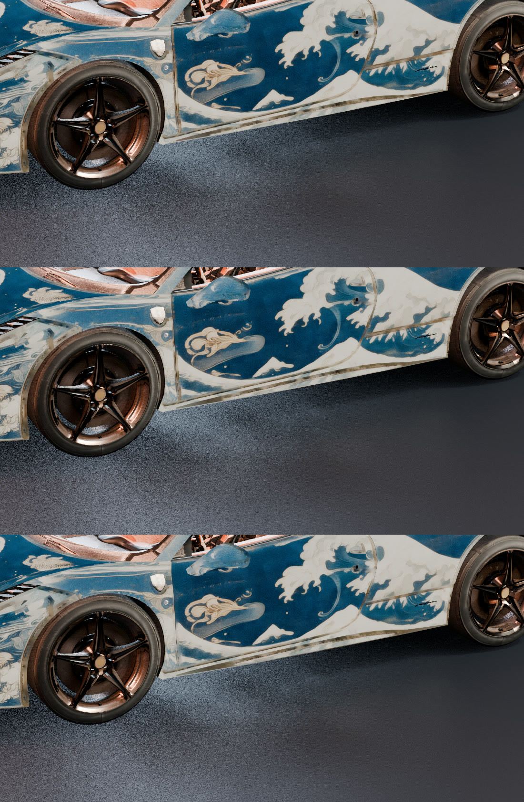

# 07 · Atlas cleanup (v12 textures)

Post-process for the step-05/06 atlases. It fixes two problems:

1. **Dark rim at every UV island border.** The video projection bakes a dark/grey band
   along each island edge. On the car it shows up as thin dark lines along every seam.
2. **Empty padding around islands.** Black padding (or stretched-pixel padding) around the
   islands bleeds into the seams at lower mip levels.

**How we found it:** rendering the body with a plain white texture made the lines
disappear. The lines were baked into the texture, not caused by geometry or shading.



<sub>top: v11 (dark seam lines) · middle: 14 px rim rebuilt · bottom: 24 px rim rebuilt (kept)</sub>

## Scripts

| Script | Runs in | Role |
|---|---|---|
| `dump_uv_pages.py` | Blender | dumps the UV triangles of every atlas page to `<page>_uv_tris.npy`, an exact island mask rasterized at full resolution (no low-res mask) |
| `seedream_fill.py` | Python + fal | Seedream 5 Pro edit fills the padding ("gutter fill") from 3 figures: the atlas with black padding, a stretched-padding guide, and the UV support mask. The prompt says to keep islands exactly as they are. Reads `FAL_KEY` from the environment |
| `recomposite.py` | Python | final composite (see below), and writes `<out>_rebuilt_mask_2k.png` so you can inspect it |

`recomposite.py`, from the inside out:

- **Island core:** kept byte-exact.
- **Rebuilt texels:** near-black texels, dark texels inside an edge zone, and an `--erode`
  px band inside each island border. They are refilled by push-pull diffusion
  (mip pyramid) from the core.
- **Guard band:** `--guard` px (40) outside the islands, filled by the same diffusion.
- **Everything further out:** the Seedream fill, so the whole atlas reads as one painted
  surface.

## Usage

```bash
# 1. UV triangles per page
blender -b final.blend -P pipeline/07_atlas_cleanup/dump_uv_pages.py -- pages/

# 2. Seedream gutter fill (paid, one call per page)
python pipeline/07_atlas_cleanup/seedream_fill.py body_8k.png pages/body_hero_8k_uv_tris.npy \
    body_stretched_guide.png seedream_body/ "Car body page: deep indigo lacquer with cream ukiyo-e waves ..."

# 3. recomposite
python pipeline/07_atlas_cleanup/recomposite.py body_8k.png pages/body_hero_8k_uv_tris.npy \
    seedream_body/seedream_fill_2k.png pages/body_hero_8k_v12.png --erode 24 --guard 40

# 4. render with the v12 pages swapped in (see explainer/blender/shots.py)
blender -b final.blend --python explainer/blender/shots.py -- --shot turntable --variant v11 \
    --texdir pages/ --pbr --frames 150 --out renders/tt_v12
```

## Parameters per page type

| Page | `--erode` | Why |
|---|---:|---|
| Big body page (8K) | 24 | the rim is wide; 14 px left traces (see the image above) |
| Small-island pages (tyres, cockpit, glass, lights, metal) | 2 | a wide band would wash out dark materials such as tyres and carbon, which are dark on purpose |

Other defaults: `--zone 24` (edge zone where dark texels count as rim), `--black 45`
(rim darkness threshold in that zone), `--global-black 30` (near-black anywhere),
`--guard 40`.

## What didn't work

| Script / approach | Why we dropped it |
|---|---|
| `seamfix.py`: stretched / nearest-texel padding | sharp streaks radiating from every island |
| `pushpull.py`: plain push-pull fill everywhere | blurry blocks in the padding; fine as a thin band, bad as the whole gutter |
| `bake_margin.py`: Blender "Adjacent Faces" bake margin | smeared halo around the islands |
| `delines.py`: global dark-line removal (black-hat) | also erased the fine livery details; the lines were only at island borders anyway |
