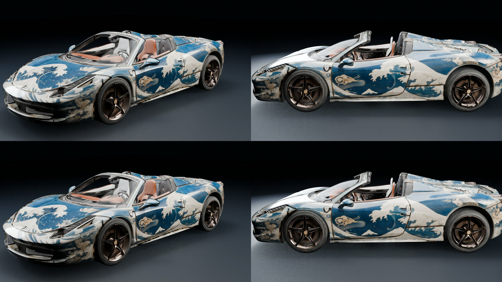

# 08 · Dirt clean pass (v13 textures)

The v12 atlases still had dull grey/brown smudges, mostly on the lower front of the body
and on the bumpers. They are **not** a padding problem: they come from the Seedance
video itself, in areas that sit in shadow or are rarely seen by the orbit camera, and the
fit baked them in.



<sub>top: v12 · bottom: v13 after the dirt clean pass</sub>

## How it works

`seedream_clean.py`, one atlas page at a time:

1. Downsizes the atlas to 2K and sends it to **Seedream 5 Pro edit** (fal) with a prompt
   that asks to remove smudges, stains, baked shadows and soot, repaint them as clean flat
   paint that continues the livery, and keep every island, outline and pattern in place.
   A short per-page guidance string describes the livery.
2. Builds a **dirt mask** at full resolution, inside the UV islands only (from the
   step-07 `<page>_uv_tris.npy`): low saturation, mid/dark value, and not indigo (the
   livery's own dark colour). The mask is opened (removes speckle), dilated by 6 px and
   feathered.
3. Composites the upscaled Seedream result **only on those dirty texels**. Everything
   else stays byte-exact. A 2K preview of the mask is written next to the output.

Applied to the body page and the exterior page (bumpers, skirts, trim).

```bash
# FAL_KEY must be set in your environment (never hard-code it)
python -I seedream_clean.py body_hero_8k_v12.png body_hero_8k_uv_tris.npy body_hero_8k_v13.png \
  "Car body: indigo lacquer with cream ukiyo-e waves, koi and gold filigree."
python -I seedream_clean.py exterior_opaque_v12.png exterior_opaque_uv_tris.npy exterior_opaque_v13.png \
  "Bumpers, skirts and trim: clean indigo and cream livery, black grilles stay black."
```

## Lessons

- Look at the source video before blaming the atlas: dirt in a dark, rarely seen area is
  usually in the video frames already.
- Let the image model repaint the whole page, but only keep its pixels where a simple,
  inspectable colour mask says so. The model is free to drift elsewhere; it does not
  matter.
