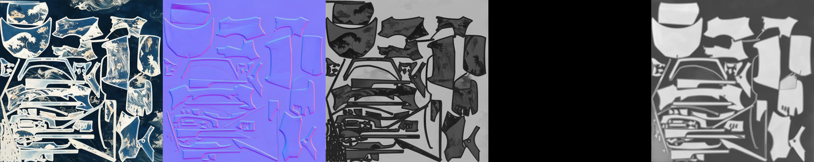
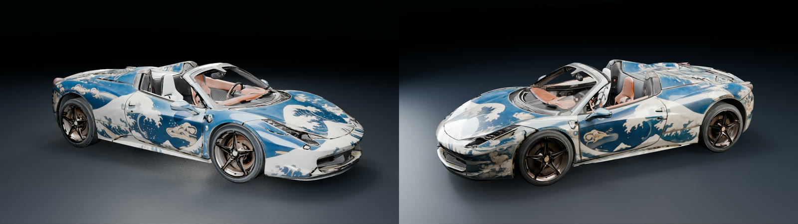

# 09 · PBR maps with PATINA

[PATINA](https://fal.ai/models/fal-ai/patina) (`fal-ai/patina` on fal) turns one image
into basecolor, normal, roughness, metalness and height maps. We run it on each atlas
page to give the baked texture real material response in Blender.



<sub>body page: basecolor · normal · roughness · metalness · height</sub>



## Scripts

| Script | Role |
|---|---|
| `patina.py` | uploads one page to fal storage, runs `fal-ai/patina` with all 5 maps, downloads them as `<prefix>_<i>_<map>.png`. Reads `FAL_KEY` from the environment |
| `run_all.sh` | runs `patina.py` on the 7 pages (body, exterior, running gear, lights, cockpit, glass, tyres) |
| `prep_pbr.py` | keeps **roughness** and **metalness** as they are; **flattens the normal map** within about 13 px of each UV island border; writes `pbr/<page>_{normal,rough,metal}.png` |

Height and basecolor are not used: colour stays our own atlas.

Then render with the maps wired into a Principled BSDF (clear coat on the body):

```bash
blender -b scene.blend --python explainer/blender/shots.py -- --shot views --pbr --pbrdir pbr --mirror-seats --out renders/pbr
```

## Lessons

- **Run PATINA on the fully padded atlas** (the step-07 output). With black gaps between
  islands it treats each island as a separate object.
- PATINA adds a **bevel around each island** in the normal map. On a UV atlas that draws
  a line along every seam, hence the border flattening in `prep_pbr.py`.
- On car paint, **metalness came out 0**, which is correct for lacquer, and **roughness**
  separates the glossy lacquer from the matte padding / trim.
